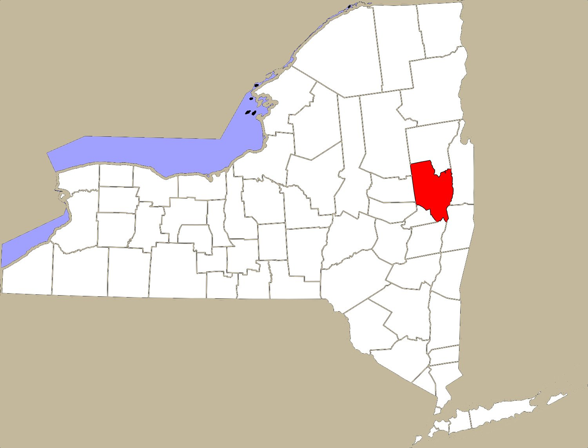

```{r}
# Libraries
library(tidyverse)
library(ggplot2)
library(scales)
library(knitr)
library(kableExtra)
library(ggfortify)
library(patchwork)


# Data load
data <- read.delim(
  "housing-prices-ge19.txt",
  header = TRUE, sep = "\t",
  quote = "", comment.char = "",
  check.names = TRUE
)

# Basic checks
missings <- colSums(is.na(data))

# Coerce factors
data <- data %>%
  mutate(
    Waterfront   = as.factor(Waterfront),
    New.Construct = as.factor(New.Construct),
    Central.Air  = as.factor(Central.Air),
    Fuel.Type    = as.factor(Fuel.Type),
    Heat.Type    = as.factor(Heat.Type),
    Sewer.Type   = as.factor(Sewer.Type),
  )

# Clean
data_cleaned <- data %>%
  filter(Lot.Size > 0) %>%
  filter(!(Age == 0 & New.Construct == 0))

data_cleaned <- data_cleaned %>%
  mutate(
    Log.Price = log(Price),
    Log.Lot.Size = log(Lot.Size),
    Log.Age = ifelse(Age != 0, log(Age), 0),
    Log.Land.Value = log(Land.Value)
  ) %>%
  select(-Price, -Lot.Size, -Age, -Land.Value, -Test)

# --- STEPWISE SELECTION ON FULL MODEL ---

M0_null <- lm(Log.Price ~ 1, data = data_cleaned)
M1_full <- lm(Log.Price ~ ., data = data_cleaned)

#Forward
step_fwd_full <- step(
  M0_null,
  scope = list(lower = M0_null, upper = M1_full),
  direction = "forward",
  trace = FALSE
)
#summary(step_fwd_full)

#Backward
step_back_full <- step(
  M1_full,
  direction = "backward",
  trace = FALSE
)
#summary(step_back_full)

#Stepwise
step_both_full <- step(
  M0_null,
  scope = list(lower = M0_null, upper = M1_full),
  direction = "both",
  trace = FALSE
)
#summary(step_both_full)

# AIC(step_fwd_full)
# AIC(step_back_full)
# AIC(step_both_full)
```

## Approach
- Through who's lens should we view the data?
- Perspectives: 
  - A homeowner considering renovations to their house to improve their property value (maybe before selling) or 
  - A property developer that, already having access to some piece of land is considering what type of houses to build on it
- Expanding on to that, how much of the price of the house is dependent on things that are changeable? To what extent can the developer or homeowner actually increase their returns having already acquired land or a pre-built property.
- To what extent do immutable property characteristics, compared to changeable attributes, explain housing price variation?


## Dataset Overview - Saratoga Housing Data
:::: {.columns}

:::{.column}
-   **1734 observations**

-   **17 variables**

-   **Dependent Variable:** Price

-   There are no missing values in the data

-   Saratoga County, New York State, 2006

- Collected for a case study: "How much is a Fireplace Worth?"


:::

:::{.column}
Column | Unit | Notes
-----|----- | ----- 
Lot.Size	| Acres | -
Living.Area	| sq^2 | -
Pct.College	| % | % of Neighborhood with College Education
Test| N/A | Random
:::

::::



## Data Cleaning

1.  Filter invalid data: 0 Lot Size
2.  Remove inconsistent data where Age = 0 and New.Construct = 0
3.  Convert certain variables from text/numeric to a categorical data type (Waterfront, New Construction, Central Air, Fuel Type, Heat Type, Sewer Type)
4.  Log transformation for variables with skewed data: Price, Lot Size, Age, Land Value

## Variable Groupings - Changeable and Unchangeable

```{r}

unchangeable <- c("Lot.Size", "Waterfront", "Age", "Land.Value")
changeable   <- c("Living.Area", "Bathrooms", "Bedrooms", "Rooms",
                  "Central.Air", "New.Construct", "Heat.Type",
                  "Fuel.Type", "Fireplaces")

pad <- function(x, n) c(x, rep("", n - length(x)))
n <- max(length(unchangeable), length(changeable))

vars_side <- data.frame(
  Unchangeable = pad(unchangeable, n),
  Changeable   = pad(changeable, n),
  check.names = FALSE
)

kable(vars_side, "html", align = "l") %>%
  kable_styling(full_width = FALSE, position = "center")
```

## Variable Selection Approach - Stepwise

-   We used **stepwise selection** methods to identify the most influential variables.

-   Three approaches tested: **Forward**, **Backward**, and **Stepwise (both)**

-   Each approach adds or removes variables based on the **Akaike Information Criterion (AIC)**.

## Stepwise Results

```{r}

results_tbl <- data.frame(
  Model = c("Forward", "Backward", "Stepwise"),
  R2 = c(summary(step_fwd_full)$r.squared,
         summary(step_back_full)$r.squared,
         summary(step_both_full)$r.squared),
  Adj_R2 = c(summary(step_fwd_full)$adj.r.squared,
             summary(step_back_full)$adj.r.squared,
             summary(step_both_full)$adj.r.squared),
  AIC = c(AIC(step_fwd_full),
          AIC(step_back_full),
          AIC(step_both_full))
)

options(knitr.kable.NA = "", kableExtra.latex.options = "scale_down")

kable(results_tbl,
      caption = "Forward, Backward, and Stepwise Selection Summary (Full Model)",
      col.names = c("Model", "R²", "Adjusted R²", "AIC"),
      align = "lccc") |>
  kable_classic(full_width = FALSE)

```


## Model Evaluation: In-Sample Performance Test

- The Living Area model is the most best among the single-predictor models.  
- The full model achieves a higher R² (around 0.63), indicating a better overall fit.  

```{r}
# Living.Area
# Log.Land.Value
# Bathrooms
# Waterfront
# Heat.Type
# Log.Age
# New.Construct

Living.Area_lm <- lm(Log.Price ~ Living.Area, data = data_cleaned)
Bathrooms_lm   <- lm(Log.Price ~ Bathrooms, data = data_cleaned)
Land.Value_lm  <- lm(Log.Price ~ Log.Land.Value, data = data_cleaned)
Waterfront_lm  <- lm(Log.Price ~ Waterfront, data = data_cleaned)
Fuel.Type_lm  <- lm(Log.Price ~ Fuel.Type, data = data_cleaned)
Age_lm  <- lm(Log.Price ~ Log.Age, data = data_cleaned)
New.Construct_lm  <- lm(Log.Price ~ New.Construct, data = data_cleaned)
Central.Air_lm  <- lm(Log.Price ~ Central.Air, data = data_cleaned)

lm_full_lm     <- lm(Log.Price ~ Living.Area + Log.Land.Value + Bathrooms + Waterfront + Fuel.Type + Log.Age + New.Construct, data = data_cleaned)

changable_lm     <- lm(Log.Price ~ Living.Area + Bathrooms + Fuel.Type + New.Construct, data = data_cleaned)

unchangable_lm     <- lm(Log.Price ~ Log.Land.Value + Waterfront +  Log.Age, data = data_cleaned)

models <- list(
  Living.Area_lm,
  Bathrooms_lm,
  # Land.Value_lm,
  # Waterfront_lm,
  # Fuel.Type_lm,
  # Age_lm,
  # New.Construct_lm,
  # Central.Air_lm,
  lm_full_lm,
  changable_lm,
  unchangable_lm
)

# model_names <- c("Living Area", "Bathrooms", "Land Value", "Waterfront", "Fuel Type", "Age", "New Construct", "Central Air", "Full Model", "Changable Variables", "Unchagable Variables")
model_names <- c("Living Area", "Bathrooms", "Full Model", "Changable Variables", "Unchagable Variables")

in_sample_tbl <- tibble(
  Model = model_names,
  R2 = sapply(models, function(m) summary(m)$r.squared),
  Adj_R2 = sapply(models, function(m) summary(m)$adj.r.squared),
  AIC = sapply(models, AIC)
)

in_sample_tbl |>
  mutate(across(where(is.numeric), round, 3)) |>
  kable(col.names = c("Model", "R²", "Adjusted R²", "AIC"), align = "lccc") |>
  kable_classic(full_width = FALSE)
```


## Out-of-Sample Performance Test 

- Living Area alone was the most effective single predictor of price.  
- This indicates that housing price is influenced by multiple property characteristics rather than any single factor.

```{r}
# Living.Area
# Log.Land.Value
# Bathrooms
# Waterfront
# Fuel.Type
# Log.Age
# New.Construct

set.seed(5)
n = nrow(data_cleaned)
n_train = floor(0.8*n)
n_test = n - n_train

grp_labs = rep(c("Train","Test"), times = c(n_train, n_test)) 
data_cleaned$grp = sample(grp_labs)

train_dat = data_cleaned |> dplyr::filter(grp == "Train")
test_dat  = data_cleaned |> dplyr::filter(grp == "Test")

Living.Area_train = lm(Log.Price ~ Living.Area, data = train_dat)
Living.Area_pred = predict(Living.Area_train, newdata = test_dat)
Living.Area_mse = mean((test_dat$Log.Price - Living.Area_pred)^2)
Living.Area_mae = mean(abs(test_dat$Log.Price - Living.Area_pred))

Log.Land.Value_train = lm(Log.Price ~ Log.Land.Value, data = train_dat)
Log.Land.Value_pred = predict(Log.Land.Value_train, newdata = test_dat)
Log.Land.Value_mse = mean((test_dat$Log.Price - Log.Land.Value_pred)^2)
Log.Land.Value_mae = mean(abs(test_dat$Log.Price - Log.Land.Value_pred))

Fuel.Type_train = lm(Log.Price ~ Fuel.Type, data = train_dat)
Fuel.Type_pred = predict(Fuel.Type_train, newdata = test_dat)
Fuel.Type_mse = mean((test_dat$Log.Price - Fuel.Type_pred)^2)
Fuel.Type_mae = mean(abs(test_dat$Log.Price - Fuel.Type_pred))

Log.Age_train = lm(Log.Price ~ Log.Age, data = train_dat)
Log.Age_pred = predict(Log.Age_train, newdata = test_dat)
Log.Age_mse = mean((test_dat$Log.Price - Log.Age_pred)^2)
Log.Age_mae = mean(abs(test_dat$Log.Price - Log.Age_pred))

New.Construct_train = lm(Log.Price ~ New.Construct, data = train_dat)
New.Construct_pred = predict(New.Construct_train, newdata = test_dat)
New.Construct_mse = mean((test_dat$Log.Price - New.Construct_pred)^2)
New.Construct_mae = mean(abs(test_dat$Log.Price - New.Construct_pred))

Bathrooms_train = lm(Log.Price ~ Bathrooms, data = train_dat)
Bathrooms_pred = predict(Bathrooms_train, newdata = test_dat)
Bathrooms_mse = mean((test_dat$Log.Price - Bathrooms_pred)^2)
Bathrooms_mae = mean(abs(test_dat$Log.Price - Bathrooms_pred))

Waterfront_train = lm(Log.Price ~ Waterfront, data = train_dat)
Waterfront_pred = predict(Waterfront_train, newdata = test_dat)
Waterfront_mse = mean((test_dat$Log.Price - Waterfront_pred)^2)
Waterfront_mae = mean(abs(test_dat$Log.Price - Waterfront_pred)) 

Central.Air_train = lm(Log.Price ~ Central.Air, data = train_dat)
Central.Air_pred = predict(Central.Air_train, newdata = test_dat)
Central.Air_mse = mean((test_dat$Log.Price - Central.Air_pred)^2)
Central.Air_mae = mean(abs(test_dat$Log.Price - Central.Air_pred)) 

lm_full_train     <- lm(Log.Price ~ Living.Area + Log.Land.Value + Bathrooms + Waterfront + Fuel.Type + Log.Age + New.Construct + Central.Air, data = train_dat)
full_pred = predict(lm_full_train, newdata = test_dat)
full_mse = mean((test_dat$Log.Price - full_pred)^2)
full_mae = mean(abs(test_dat$Log.Price - full_pred))

changable_lm     <- lm(Log.Price ~ Living.Area + Bathrooms + Fuel.Type + New.Construct + Central.Air, data = train_dat)
changable_pred = predict(lm_full_train, newdata = test_dat)
changable_mse = mean((test_dat$Log.Price - changable_pred)^2)
changable_mae = mean(abs(test_dat$Log.Price - changable_pred))

unchangable_lm     <- lm(Log.Price ~ Log.Land.Value + Waterfront +  Log.Age, data = train_dat)
unchangable_pred = predict(unchangable_lm, newdata = test_dat)
unchangable_mse = mean((test_dat$Log.Price - unchangable_pred)^2)
unchangable_mae = mean(abs(test_dat$Log.Price - unchangable_pred))

results_tbl <- tibble(
  # Model = c("Living Area", "Bathrooms", "Land Value", "Waterfront", "Fuel Type", "Age", "New Construct", "Central.Air", "Full Model", "Changable Variables", "Unchagable Variables"),
    Model = c("Living Area", "Bathrooms", "Full Model", "Changable Variables", "Unchagable Variables"),
  RMSE = c(sqrt(Living.Area_mse),
           sqrt(Bathrooms_mse),
           # sqrt(Log.Land.Value_mse),
           # sqrt(Waterfront_mse),
           # sqrt(Fuel.Type_mse),
           # sqrt(Log.Age_mse),
           # sqrt(New.Construct_mse),
           # sqrt(Central.Air_mse),
           
           sqrt(full_mse),
           sqrt(changable_mse),
           sqrt(unchangable_mse)),
  MAE = c(Living.Area_mae,
          Bathrooms_mae,
          # Log.Land.Value_mae,
          # Waterfront_mae,
          # Fuel.Type_mae,
          # Log.Age_mae,
          # New.Construct_mae,
          # Central.Air_mae,
          
          full_mae,
          changable_mae,
          unchangable_mae),
)

results_tbl |>
  mutate(across(where(is.numeric), round, 2)) |>
  kable(col.names = c("Model", "RMSE", "MAE"), align = "lcc") |>
  kable_classic(full_width = FALSE)
```

## Final Chosen Model

```{r}

summary(step_back_full)

```

## Assumption Check - Linearity
```{r, message=FALSE, warning=FALSE}

vars <- c("Living.Area", "Log.Land.Value", "Bathrooms", "Log.Age")

plots <- lapply(vars, function(v){
  ggplot(data_cleaned, aes_string(v, resid(step_both_full))) +
    geom_point(color = "gray40", size = 0.8) +
    geom_hline(yintercept = 0) +
    geom_smooth(method = "loess", se = FALSE) +
    labs(x = v, y = "Residuals") +
    theme_minimal(base_size = 9) +
    theme(panel.grid.minor = element_blank(),
          plot.title = element_text(size = 10),
          axis.title = element_text(size = 8))
})

# Arrange them nicely: 2 columns
combined <- wrap_plots(plots, ncol = 2)
combined

```
The residuals are relatively randomly scattered around the zero lines. Hence, the linearity assumption is satisfied.

## Assumption Check - Homoscedasticity
```{r, message=FALSE}
ggplot(data_cleaned, aes(x = fitted(step_both_full), y = resid(step_both_full))) +
    geom_point(color = "gray40", size = 0.8) +
    geom_hline(yintercept = 0) +
    labs(x = "Fitted values", y = "Residuals") +
    theme_minimal(base_size = 9) +
    theme(panel.grid.minor = element_blank(),
          plot.title = element_text(size = 10),
          axis.title = element_text(size = 8))
```
The spread looks reasonably constant over the range of fitted log price values. Hence, the homoscedasticity assumption for the residuals is satisfied.

## Assumption Check - Normality
```{r}
data_cleaned |> ggplot() + 
  aes(sample = resid(step_both_full)) +
  geom_qq(size = 2) + geom_qq_line() +
  labs(title = "Normal Q-Q", x = "Theoretical quantiles", y = "Standardized residuals") +
  theme_minimal()
```
The majority of the points lie quite close to the diagonal line in the Q-Q plot. Hence, the normality assumption for the residuals is well satisfied.

## Assumption Check - Multicollinearity
```{r}
continuous_vars <- c("Living.Area", "Log.Land.Value", "Bathrooms", "Log.Age") # Fwd
numeric_data <- data_cleaned[, (names(data_cleaned) %in% continuous_vars)]
cor_mat = cor(numeric_data)
melted_cor_mat = cor_mat |>
  data.frame() |>
  rownames_to_column(var = "var1") |>
  pivot_longer(cols = -var1,
               names_to = "var2",
               values_to = "cor")
melted_cor_mat |> ggplot() + 
  aes(x=var1, y=var2, fill=cor) + 
  geom_tile() + 
  # theme_minimal(base_size = 30) +
  scale_fill_gradient2(
    low = "blue", 
    high = "red", 
    mid = "white", 
    midpoint = 0, 
    limit = c(-1,1)) +
  theme(
    axis.text.x = element_text(
      angle = 90, hjust = 1
    )
  )
```

There is no multicollinearity as no pair of predictors are highly correlated (i.e., having |r| > 0.8).

## Discussion: Coefficients
:::: {.columns}
::: {.column width="60%"}
```{r}
library(tibble)
library(gt)

effects <- tribble(
  ~Variable,           ~`Change in unit`, ~`Impact on price (%)`,
  "Living area",       "+100 sq ft",      "+2.89%",
  "Land value",        "+10%",            "+1.18%",
  "Bathrooms",         "+1",              "+10.26%",
  "Waterfront",        "Yes",             "+76.03%",
  "Central air",       "Yes",             "+5.82%",
  "Fuel: gas",         "Yes",   "+8.66%",
  "Fuel: wood",        "Yes",   "-64.12%",
  "Age",               "+10%",            "-0.50%",
  "New construction",  "Yes",             "-21.82%"
)

gt(effects)
```

:::
::: {.column width="40%"}

:::
::::

## Key Takeaways - Changeable attributes
Useful for *homeowners* looking to renovate and increase the value of their house. 

- Renovation choice: $350\ \text{sq ft} \approx 1\ \text{bathroom} \approx \text{Hot air heating}$
- Average bathroom size in the US: 40-100 square feet
- Practical considerations: construction costs etc.


## Key Takeaways - Immutable attributes
Useful for *prospective buyers/sellers*. 

- Waterfront is associated the highest increase in housing price

**Changeable and unchangeable attributes both matter.**

- For both users, this helps set realistic expectations
- Buyers: renovation is not everything 
- Homeowners: don't be complacent if you have a nice waterfront


## Limitations and Future Work
:::: {.columns}
::: {.column width="40%"}
#### Representativeness 
- 2006, GFC
- Saratoga ≠ NYC: suburban ≠ urban

#### Unrecorded variables

#### Risk of overfitting

#### Future work
- More recent / time series
- More variables
- Interactive geographic visualisations 

:::
::: {.column width="60%"}

:::
::::
